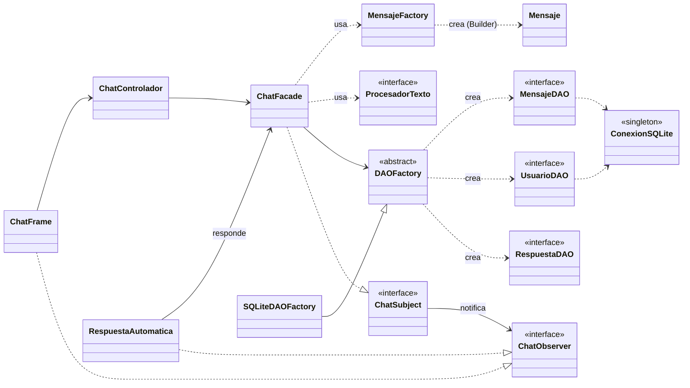

# ChatUp 💬

Aplicación de mensajería de escritorio (estilo WhatsApp, versión simple) desarrollada para el curso **Tecnología de Objetos**.

| Requisito         | Implementación                          |
|-------------------|-----------------------------------------|
| Lenguaje          | Java 17                                 |
| GUI               | Swing                                   |
| Base de datos     | SQLite local (`chatup.db`, driver `sqlite-jdbc`) |
| Patrones de diseño| Singleton, Builder, Factory Method, Abstract Factory, DAO, Strategy, Observer, Facade y MVC |

## Funcionalidades

- Inicio de sesión y registro de usuarios (contraseña guardada con hash SHA-256).
- Lista de contactos con avatar, vista previa del último mensaje y contador de no leídos.
- Chat con burbujas, hora y doble check ✓✓.
- **Varias sesiones a la vez**: con el botón **+** se abre otra ventana con otro usuario y los mensajes llegan en tiempo real (patrón Observer).
- **Respuestas automáticas**: al enviar un mensaje, el contacto "escribe…" y responde con una frase aleatoria guardada en la tabla `respuestas` de SQLite ("Creo que es cierto", "De acuerdo", "Puedo analizar lo que dices"…).
- **Zumbido**: hace temblar la ventana del destinatario.
- **Procesamiento de texto** elegible antes de enviar (patrón Strategy): Normal, Emoticonos (`:)` → ☺, `<3` → ♥), Censura y MAYÚSCULAS.
- Cambiar el estado del perfil (✎) y vaciar un chat.
- Todo queda guardado en `chatup.db`.

Usuarios de prueba (se crean solos la primera vez): **ana**, **luis** y **maria**, todos con la clave **1234**.

## Cómo ejecutar

Requiere **JDK 17 o superior**.

**Opción 1: script (sin Maven).** Descarga el driver de SQLite, compila y ejecuta:

```bash
./run.sh        # macOS / Linux
run.bat         # Windows
```

**Opción 2: Maven / IDE.** Abrir la carpeta en NetBeans, IntelliJ o VS Code como proyecto Maven y ejecutar `com.chatup.Main`, o bien:

```bash
mvn package
java -jar target/chatup-1.0-jar-with-dependencies.jar
```

> Prueba rápida: entra como `ana`, pulsa **+**, entra como `luis` en la segunda ventana y escríbanse.

## Patrones de diseño aplicados

| Patrón | Tipo | Dónde | Para qué |
|---|---|---|---|
| **Singleton** | Creacional | [`config/ConexionSQLite`](src/main/java/com/chatup/config/ConexionSQLite.java) | Una sola conexión a SQLite para toda la app; además crea las tablas. |
| **Builder** | Creacional | [`modelo/Mensaje.Builder`](src/main/java/com/chatup/modelo/Mensaje.java) | Construir mensajes inmutables paso a paso y validar campos obligatorios. |
| **Factory Method** | Creacional | [`factory/MensajeFactory`](src/main/java/com/chatup/factory/MensajeFactory.java) | Crear mensajes de tipo TEXTO, RESPUESTA_AUTO, ZUMBIDO o SISTEMA sin que el cliente sepa cómo se arman. |
| **Abstract Factory** | Creacional | [`dao/DAOFactory`](src/main/java/com/chatup/dao/DAOFactory.java) → [`SQLiteDAOFactory`](src/main/java/com/chatup/dao/sqlite/SQLiteDAOFactory.java) | Crear la familia de DAOs; cambiar de motor de BD = otra fábrica concreta. |
| **DAO** | Arquitectura / acceso a datos | [`dao/UsuarioDAO`](src/main/java/com/chatup/dao/UsuarioDAO.java), [`dao/MensajeDAO`](src/main/java/com/chatup/dao/MensajeDAO.java), [`dao/RespuestaDAO`](src/main/java/com/chatup/dao/RespuestaDAO.java) y sus implementaciones en `dao/sqlite` | Separar el SQL de la lógica de negocio. |
| **Strategy** | Comportamiento | [`estrategia/ProcesadorTexto`](src/main/java/com/chatup/estrategia/ProcesadorTexto.java) + `TextoNormal`, `TextoEmoticonos`, `TextoCensurado`, `TextoMayusculas` | Algoritmos intercambiables para transformar el texto; se eligen en un combo de la GUI. |
| **Observer** | Comportamiento | [`observador/ChatSubject`](src/main/java/com/chatup/observador/ChatSubject.java) (lo implementa `ChatFacade`) y [`ChatObserver`](src/main/java/com/chatup/observador/ChatObserver.java) (lo implementan `ChatFrame` y [`RespuestaAutomatica`](src/main/java/com/chatup/servicio/RespuestaAutomatica.java)) | Notificar en vivo a todas las ventanas abiertas cuando llega un mensaje; el bot de respuestas es otro observador. |
| **Facade** | Estructural | [`servicio/ChatFacade`](src/main/java/com/chatup/servicio/ChatFacade.java) | Interfaz simple para la GUI que oculta DAOs, fábricas, estrategias y el hash. |
| **MVC** | Arquitectónico | `modelo/` · `vista/` · `controlador/` | Separar datos, interfaz y manejo de eventos. |

## Estructura

```
src/main/java/com/chatup/
├── Main.java                 # punto de entrada
├── config/                   # Singleton: ConexionSQLite
├── modelo/                   # Usuario, Mensaje (Builder), TipoMensaje
├── factory/                  # Factory Method: MensajeFactory
├── dao/                      # DAO + Abstract Factory
│   └── sqlite/               # implementaciones SQLite
├── estrategia/               # Strategy: procesadores de texto
├── observador/               # Observer: ChatSubject / ChatObserver
├── servicio/                 # Facade: ChatFacade · Observer: RespuestaAutomatica (bot)
├── controlador/              # MVC: LoginControlador, ChatControlador
└── vista/                    # MVC: LoginFrame, ChatFrame, Burbuja, Avatar, Estilo
```

## Diagrama de clases (resumen)



## Base de datos

`chatup.db` se crea automáticamente en la carpeta desde donde se ejecuta:

```sql
CREATE TABLE usuarios (
    id            INTEGER PRIMARY KEY AUTOINCREMENT,
    username      TEXT NOT NULL UNIQUE,
    nombre        TEXT NOT NULL,
    password_hash TEXT NOT NULL,
    estado        TEXT
);

CREATE TABLE mensajes (
    id              INTEGER PRIMARY KEY AUTOINCREMENT,
    remitente_id    INTEGER NOT NULL REFERENCES usuarios(id),
    destinatario_id INTEGER NOT NULL REFERENCES usuarios(id),
    contenido       TEXT NOT NULL,
    tipo            TEXT NOT NULL,   -- TEXTO | RESPUESTA_AUTO | ZUMBIDO | SISTEMA
    fecha           TEXT NOT NULL    -- ISO-8601
);

-- Frases que usa el bot de respuestas automáticas (25 precargadas)
CREATE TABLE respuestas (
    id    INTEGER PRIMARY KEY AUTOINCREMENT,
    texto TEXT NOT NULL UNIQUE
);
```
